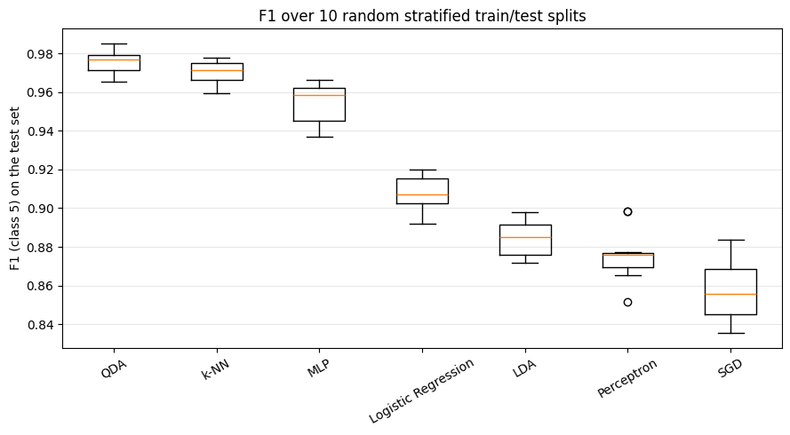
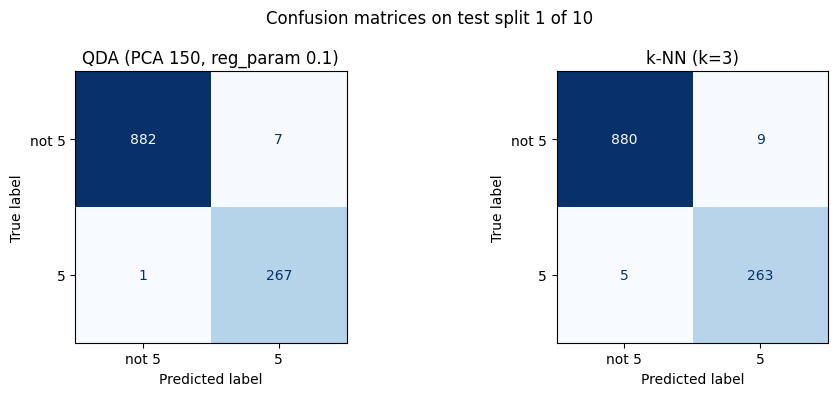

# Comparing 7 Classifiers on Handwritten Digits (5 vs 0/8/9)

[](https://colab.research.google.com/github/sarabaranes-dev/ml-classifier-comparison/blob/main/mnist_rework.ipynb)

A reproducible comparison of seven scikit-learn classifiers on a binary handwritten-digit task: recognising the digit **5** among the digits **0, 8 and 9**. Each model is tuned with cross-validation on the training data only and evaluated on 10 random stratified train/test splits.



## Background

This project started in the *Data Mining and Machine Learning* course at the Universitat de València (Erasmus+, 2025), as a team project of two students. The original experiment used a course dataset (`BigDigits.mat`) that is no longer available.

In 2026 I re-ran the experiment on a public dataset so that anyone can reproduce it:

- The original notebook printed the number of images per digit in BigDigits: `980, 1135, 1032, 1010, 982, 892, 958, 1028, 974, 1009`. These are exactly the class counts of the **MNIST test set** (10,000 images, 28×28 pixels), so the rework uses that set, downloaded from OpenML.
- The task is the same as in the original run: digit 5 against digits 9, 8 and 0.
- The evaluation protocol was redesigned to fix some methodological issues of the original (see [What changed from the original](#what-changed-from-the-original)).

The original course notebook is kept unchanged in [`ml_classifier_comparison.ipynb`](ml_classifier_comparison.ipynb) for reference. It cannot be run without the original data file.

## Data

| | |
|---|---|
| Source | MNIST (`mnist_784` on OpenML), last 10,000 rows = official test set |
| Images used | 3,855 (digits 0, 5, 8, 9) |
| Positive class (label 1) | digit 5: 892 images |
| Negative class (label 0) | digits 0, 8, 9: 2,963 images |
| Features | 784 pixel values, scaled to [0, 1] |

The classes are imbalanced (about 1:3), so the main metric is the **F1 score of the positive class (digit 5)**. ROC AUC and accuracy are also reported.

## Method

1. **10 random stratified train/test splits** (70% / 30%, `random_state=42`). All models are evaluated on the same 10 splits.
2. **Hyperparameter tuning on the training set only**: `GridSearchCV` with 5-fold cross-validation, optimising F1. The test set of each split is used once, to score the selected model.
3. **Preprocessing inside the pipeline**: models that need it use a `StandardScaler` (and QDA a `PCA`) fitted on the training folds only, so no information leaks from the test set.
4. **Results** are reported as mean ± standard deviation over the 10 splits.
5. **Grid boundaries**: when the best value was at the edge of a grid, the grid was extended once in that direction and then frozen.

| Model | Pipeline | Grid searched | Most frequent choice (out of 10 splits) |
|---|---|---|---|
| k-NN | – | `n_neighbors` 1, 3, 5, 7, 9, 11; `weights` uniform, distance | k=3 (5), k=5 (4), k=7 (1); always uniform |
| Perceptron | scaler | `alpha` 1e-4, 1e-3, 1e-2; `penalty` none, l2, l1 | alpha=1e-3, l1 (7) |
| SGD | scaler | `loss` hinge, log_loss; `alpha` 0.1, 1, 10 | hinge, alpha=1 (9) |
| Logistic Regression | scaler | `C` 0.001, 0.01, 0.1, 1 | C=0.1 (8) |
| LDA | – (solver `lsqr`) | `shrinkage` auto, 0.1, 0.5, 0.9 | 0.1 (5), 0.5 (5) |
| QDA | PCA | `n_components` 50, 100, 150; `reg_param` 0.01, 0.1, 0.5 | 150 (5), 100 (4); reg_param=0.1 (9) |
| MLP (1 hidden layer, early stopping) | scaler | `hidden_layer_sizes` 100, 200; `alpha` 1, 10 | 200 units (8); alpha=1 (7) |

## Results

| Model | Accuracy | F1 (class 5) | ROC AUC |
|:--|:--|:--|:--|
| **QDA (on PCA features)** | 0.989 ± 0.003 | **0.975 ± 0.006** | 0.999 ± 0.000 |
| **k-NN** | 0.986 ± 0.003 | **0.970 ± 0.006** | 0.995 ± 0.001 |
| MLP | 0.979 ± 0.005 | 0.954 ± 0.011 | 0.993 ± 0.006 |
| Logistic Regression | 0.957 ± 0.004 | 0.907 ± 0.009 | 0.981 ± 0.004 |
| LDA | 0.945 ± 0.004 | 0.884 ± 0.009 | 0.975 ± 0.004 |
| Perceptron | 0.941 ± 0.007 | 0.876 ± 0.014 | 0.964 ± 0.005 |
| SGD | 0.940 ± 0.006 | 0.857 ± 0.016 | 0.973 ± 0.006 |

Confusion matrices of the two best models on one test split (split 1 of 10, 1,157 images):



On this split QDA makes 8 errors (7 false alarms, 1 missed 5) and k-NN makes 14 (9 false alarms, 5 missed 5s).

## Conclusion

- **QDA on PCA features and k-NN are the best models**, with equivalent F1 scores: the difference (0.975 vs 0.970) is smaller than the variation between splits.
- The **linear models** (Logistic Regression, LDA, Perceptron, SGD) are clearly behind (F1 0.86–0.91). A single linear boundary is not enough to separate the many ways of writing a 5 from the other digits, while k-NN, QDA and the MLP can model non-linear boundaries.
- **QDA went from the worst to the best model.** In the original run it was used on the raw 784 pixels, where it cannot estimate a full covariance matrix per class (about 620 training images of the digit 5 against 784 features), and it scored close to chance. Reducing the data to 50–150 PCA components first makes the estimate possible.

## What changed from the original

| Original (2025) | Rework (2026) |
|---|---|
| Hyperparameters chosen by looking at test-set scores | Tuning with cross-validation on the training set only |
| MLP and linear models trained on unscaled pixels | `StandardScaler` inside a pipeline |
| QDA on 784 raw pixels (ROC AUC 0.51 on the first split) | PCA before QDA, with regularisation |
| F1 computed on the majority class (digits 0, 8, 9) | F1 computed on the digit 5 |
| 3–5 splits, the "other" digits chosen at random without a seed | 10 seeded stratified splits, fixed digits |
| Private dataset, now lost | Public dataset (MNIST via OpenML) |

## Limitations

- The rework uses the MNIST test set, which has the same class counts as BigDigits. Whether the two files are identical (image order, pixel scaling) cannot be checked, because the original file is lost.
- One binary task only (5 vs 0/8/9); the results do not cover the full 10-class problem.
- The 10 splits are drawn from the same 3,855 images and overlap, so the standard deviations show stability rather than formal confidence intervals.
- The confusion matrices refer to a single split and are an example, not a general result.

## How to run

**On Google Colab (tested):** click the *Open in Colab* badge above, then *Runtime → Run all*. The full run takes up to about an hour on a free Colab instance and needs internet access to download MNIST.

**Locally:**

```bash
git clone https://github.com/sarabaranes-dev/ml-classifier-comparison.git
cd ml-classifier-comparison
python -m venv .venv
source .venv/bin/activate        # Windows: .venv\Scripts\activate
pip install -r requirements.txt jupyter
jupyter notebook mnist_rework.ipynb
```

All splits and models use fixed random seeds, so a full re-run gives the same numbers. The notebook runs SGD, QDA and MLP twice: the second run (extended grids) is the one reported above.

## Repository structure

```
├── mnist_rework.ipynb             # the reproducible experiment (2026)
├── ml_classifier_comparison.ipynb # original course notebook (2025, needs BigDigits.mat)
├── f1_boxplot.png                 # F1 over the 10 splits
├── confusion_matrices.png         # QDA and k-NN on split 1
└── requirements.txt
```

## Tech stack

Python, scikit-learn, NumPy, pandas, Matplotlib, Google Colab.

## My role

- **Original course project (2025, team of 2):** we divided the seven models between us, each tuned their own models, and then we compared the best configurations together and chose the final model.
- **Rework (2026, individual):** I identified the replacement dataset, redesigned the evaluation protocol (cross-validated tuning, scaling and PCA pipelines, 10 seeded splits), ran all seven models and wrote the analysis.

---

## 🇮🇹 Versione italiana

# Confronto di 7 classificatori su cifre scritte a mano (5 contro 0/8/9)

Confronto riproducibile di sette classificatori scikit-learn su un problema binario di cifre scritte a mano: riconoscere la cifra **5** tra le cifre **0, 8 e 9**. Per ogni modello gli iperparametri vengono scelti con la validazione incrociata usando solo i dati di training, e la valutazione avviene su 10 divisioni train/test casuali e stratificate.

### Contesto

Il progetto nasce nel corso *Data Mining and Machine Learning* all'Universitat de València (Erasmus+, 2025), come lavoro di gruppo di due studenti. L'esperimento originale usava un dataset del corso (`BigDigits.mat`) che non è più disponibile.

Nel 2026 ho rifatto l'esperimento su un dataset pubblico, così che chiunque possa riprodurlo:

- Il notebook originale stampava il numero di immagini per cifra in BigDigits: `980, 1135, 1032, 1010, 982, 892, 958, 1028, 974, 1009`. Sono esattamente i conteggi del **test set di MNIST** (10.000 immagini 28×28 pixel), quindi il rifacimento usa quell'insieme, scaricato da OpenML.
- Il problema è lo stesso dell'esecuzione originale: la cifra 5 contro le cifre 9, 8 e 0.
- Il protocollo di valutazione è stato riprogettato per correggere alcuni problemi di metodo dell'originale (vedi [Cosa cambia rispetto all'originale](#cosa-cambia-rispetto-alloriginale)).

Il notebook originale del corso resta invariato in [`ml_classifier_comparison.ipynb`](ml_classifier_comparison.ipynb) come riferimento. Non si può eseguire senza il file di dati originale.

### Dati

| | |
|---|---|
| Fonte | MNIST (`mnist_784` su OpenML), ultime 10.000 righe = test set ufficiale |
| Immagini usate | 3.855 (cifre 0, 5, 8, 9) |
| Classe positiva (etichetta 1) | cifra 5: 892 immagini |
| Classe negativa (etichetta 0) | cifre 0, 8, 9: 2.963 immagini |
| Feature | 784 valori di pixel, scalati in [0, 1] |

Le classi sono sbilanciate (circa 1 a 3), quindi la metrica principale è l'**F1 della classe positiva (la cifra 5)**. Sono riportate anche ROC AUC e accuracy.

### Metodo

1. **10 divisioni train/test casuali e stratificate** (70% / 30%, `random_state=42`). Tutti i modelli sono valutati sulle stesse 10 divisioni.
2. **Scelta degli iperparametri solo sul training set**: `GridSearchCV` con validazione incrociata a 5 fold, ottimizzando l'F1. Il test set di ogni divisione si usa una sola volta, per valutare il modello scelto.
3. **Pre-elaborazione dentro la pipeline**: i modelli che ne hanno bisogno usano uno `StandardScaler` (e QDA una `PCA`) addestrato solo sui fold di training, così nessuna informazione passa dal test set.
4. **I risultati** sono riportati come media ± deviazione standard sulle 10 divisioni.
5. **Limiti della griglia**: quando il valore migliore era all'estremo della griglia, la griglia è stata allargata una volta in quella direzione e poi bloccata.

| Modello | Pipeline | Griglia provata | Scelta più frequente (su 10 divisioni) |
|---|---|---|---|
| k-NN | – | `n_neighbors` 1, 3, 5, 7, 9, 11; `weights` uniform, distance | k=3 (5), k=5 (4), k=7 (1); sempre uniform |
| Perceptron | scaler | `alpha` 1e-4, 1e-3, 1e-2; `penalty` nessuna, l2, l1 | alpha=1e-3, l1 (7) |
| SGD | scaler | `loss` hinge, log_loss; `alpha` 0.1, 1, 10 | hinge, alpha=1 (9) |
| Logistic Regression | scaler | `C` 0.001, 0.01, 0.1, 1 | C=0.1 (8) |
| LDA | – (solver `lsqr`) | `shrinkage` auto, 0.1, 0.5, 0.9 | 0.1 (5), 0.5 (5) |
| QDA | PCA | `n_components` 50, 100, 150; `reg_param` 0.01, 0.1, 0.5 | 150 (5), 100 (4); reg_param=0.1 (9) |
| MLP (1 livello nascosto, early stopping) | scaler | `hidden_layer_sizes` 100, 200; `alpha` 1, 10 | 200 neuroni (8); alpha=1 (7) |

### Risultati

| Modello | Accuracy | F1 (classe 5) | ROC AUC |
|:--|:--|:--|:--|
| **QDA (su componenti PCA)** | 0.989 ± 0.003 | **0.975 ± 0.006** | 0.999 ± 0.000 |
| **k-NN** | 0.986 ± 0.003 | **0.970 ± 0.006** | 0.995 ± 0.001 |
| MLP | 0.979 ± 0.005 | 0.954 ± 0.011 | 0.993 ± 0.006 |
| Logistic Regression | 0.957 ± 0.004 | 0.907 ± 0.009 | 0.981 ± 0.004 |
| LDA | 0.945 ± 0.004 | 0.884 ± 0.009 | 0.975 ± 0.004 |
| Perceptron | 0.941 ± 0.007 | 0.876 ± 0.014 | 0.964 ± 0.005 |
| SGD | 0.940 ± 0.006 | 0.857 ± 0.016 | 0.973 ± 0.006 |

I grafici sono quelli della versione inglese qui sopra. Sulla divisione 1 di 10 (1.157 immagini di test) QDA fa 8 errori (7 falsi allarmi, 1 cinque non riconosciuto) e k-NN ne fa 14 (9 falsi allarmi, 5 cinque non riconosciuti).

### Conclusione

- **QDA su componenti PCA e k-NN sono i modelli migliori**, con F1 equivalenti: la differenza (0,975 contro 0,970) è più piccola della variazione tra una divisione e l'altra.
- I **modelli lineari** (Logistic Regression, LDA, Perceptron, SGD) restano nettamente indietro (F1 0,86–0,91). Un unico confine lineare non basta a separare i tanti modi di scrivere un 5 dalle altre cifre, mentre k-NN, QDA e l'MLP possono rappresentare confini non lineari.
- **QDA è passato da modello peggiore a modello migliore.** Nell'esecuzione originale lavorava direttamente sui 784 pixel, dove non può stimare una matrice di covarianza completa per ogni classe (circa 620 immagini di training della cifra 5 contro 784 feature), e il risultato era vicino al caso. Ridurre prima i dati a 50–150 componenti PCA rende la stima possibile.

### Cosa cambia rispetto all'originale

| Originale (2025) | Rifacimento (2026) |
|---|---|
| Iperparametri scelti guardando i risultati sul test set | Scelta con validazione incrociata solo sul training set |
| MLP e modelli lineari addestrati sui pixel non standardizzati | `StandardScaler` dentro una pipeline |
| QDA sui 784 pixel grezzi (ROC AUC 0,51 sulla prima divisione) | PCA prima di QDA, con regolarizzazione |
| F1 calcolato sulla classe maggioritaria (cifre 0, 8, 9) | F1 calcolato sulla cifra 5 |
| 3–5 divisioni, le "altre" cifre scelte a caso senza seed | 10 divisioni stratificate con seed, cifre fisse |
| Dataset privato, ora perso | Dataset pubblico (MNIST via OpenML) |

### Limiti

- Il rifacimento usa il test set di MNIST, che ha gli stessi conteggi per cifra di BigDigits. Non si può verificare se i due file siano identici (ordine delle immagini, scala dei pixel), perché il file originale è perso.
- Un solo problema binario (5 contro 0/8/9); i risultati non coprono il problema completo a 10 classi.
- Le 10 divisioni provengono dalle stesse 3.855 immagini e si sovrappongono, quindi le deviazioni standard indicano la stabilità e non sono intervalli di confidenza formali.
- Le matrici di confusione si riferiscono a una sola divisione e sono un esempio, non un risultato generale.

### Come eseguirlo

**Su Google Colab (testato):** clicca il pulsante *Open in Colab* in alto, poi *Runtime → Esegui tutto*. L'esecuzione completa richiede fino a circa un'ora su un'istanza gratuita di Colab e serve la connessione a internet per scaricare MNIST.

**In locale:** usa i comandi della sezione *How to run* in inglese.

Tutte le divisioni e tutti i modelli usano seed fissi, quindi una nuova esecuzione dà gli stessi numeri. Il notebook esegue due volte SGD, QDA e MLP: i risultati riportati sono quelli della seconda esecuzione (griglie allargate).

### Tecnologie

Python, scikit-learn, NumPy, pandas, Matplotlib, Google Colab.

### Il mio ruolo

- **Progetto originale del corso (2025, gruppo di 2):** ci siamo divisi i sette modelli, ognuno ha scelto gli iperparametri dei propri, e poi abbiamo confrontato insieme le configurazioni migliori e scelto il modello finale.
- **Rifacimento (2026, individuale):** ho individuato il dataset sostitutivo, riprogettato il protocollo di valutazione (scelta degli iperparametri con validazione incrociata, pipeline con standardizzazione e PCA, 10 divisioni con seed), eseguito tutti e sette i modelli e scritto l'analisi.
